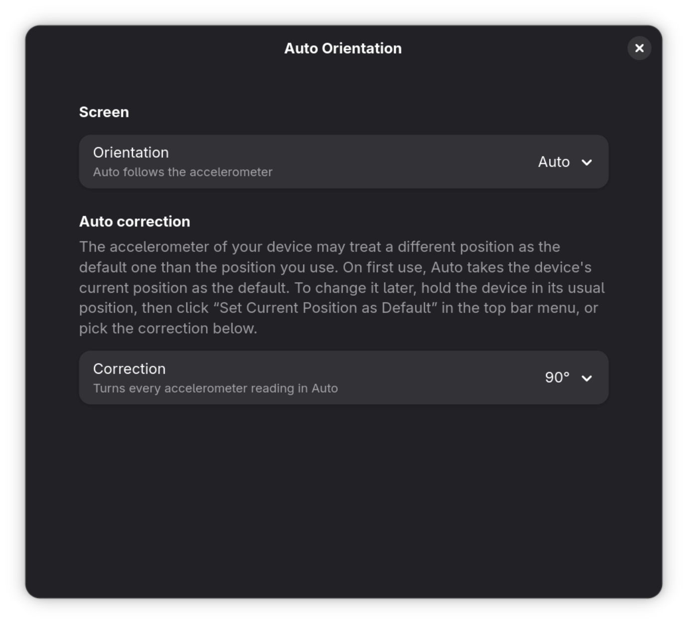
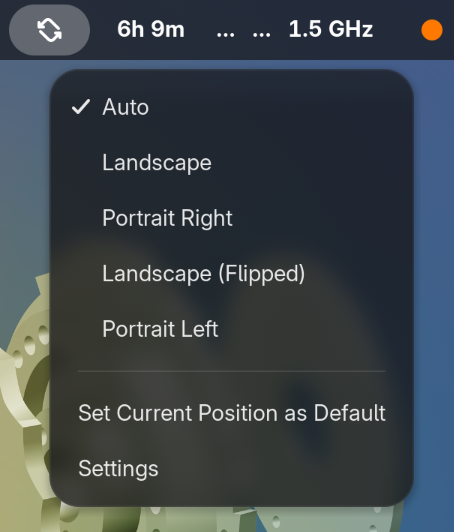

<sup>This project has been generated using ['A-GNOME-Extension-Template' (AGET)](https://github.com/a-mcorp/a-gnome-extension-template).</sup>

# Auto Orientation

> ⚠️
> __Experimental:__ this extension is a prototype, developed and tested on a single device (CHUWI MiniBook X with Fedora Silverblue). It is not published on [extensions.gnome.org](https://extensions.gnome.org) and may change or break at any time. Use it at your own risk.

> [!TIP]
> __First results:__ my initial tests on the laptop were successful, and so far this extension has worked better for me than the other auto-rotation extensions I tried on GNOME.

## Metadata
<!-- - Author: {author-name}/{author-alias}. -->
- Name: 'a-gnome-auto-orientation'.
- Purpose: automatic screen rotation from the accelerometer, for convertible laptops that GNOME does not detect as tablets (e.g. CHUWI MiniBook X).
- Format: GNOME Shell extension (`auto-orientation@a-mcorp.github.io`).
  -  this extension is currently **not** published, but upon further testing it might be.
- License:
  - This project's license: [GNU General Public License v3.0](LICENSE), with additional terms (attribution, name) in [NOTICE](NOTICE); Copyright © 2026 Mateusz Adamczyk (M.A.)
  <!-- - Dependency-1: [{dependency-1-name}]({dependency-1-license}) -->
  <!-- - Dependency-2: [{dependency-2-name}]({dependency-2-license}) -->

## Features
<table>
<tr>
<th colspan="2">Features and Examples</th>
</tr>
<tr>
<td colspan="2">

- Auto: rotates the built-in screen in all four orientations, after the accelerometer reading and an offset window.
- Auto correction: on many tablets and convertible laptops, the accelerometer is mounted at an angle to the screen. On first use, the extension takes the position the device is in (the way it is set up for daily use) as the default.
  - The additional setting called "Set Current Position as Default" (in the top bar menu, or the preferences), changes this default position later.
- Manual options: Landscape, Portrait Right, Landscape (Flipped) and Portrait Left, set from the top bar menu or the extension's preferences window.
- Top bar icon with the orientation menu; the icon shows whether rotation is automatic or locked.
- Rotates through GNOME's own display interface (`org.gnome.Mutter.DisplayConfig`), without changing kernel parameters, and without saving the rotation into `monitors.xml`.
  - This avoids conflicts on devices that already correct their screen with kernel parameters (e.g. `video=DSI-1:panel_orientation={...}`), which some other rotation extensions seem to run into.
- The extension restores the original orientation when it is turned off, and uses the accelerometer only in Auto mode.
  - In a fixed orientation, the accelerometer is released, so the extension does not drain the battery more than needed.
  - If the extension is not what you need, turning it off leaves the screen exactly as it was before, with nothing to undo by hand!

</td>
</tr>
<tr>
<th>Preferences</th>
<th>Top bar menu</th>
</tr>
<tr>
<td align="center"></td>
<td align="center"></td>
</tr>
</table>

## Setup
<table>
<tr>
<th>Dependencies</th>
<th>Usage</th>
</tr>
<tr>
<td valign="top">

  - Language: [__TypeScript__](https://www.typescriptlang.org/) (strict), transpiled to JavaScript (ES modules)
  - Target: [__GNOME Shell__](https://gitlab.gnome.org/GNOME/gnome-shell) __50, 51__ ([GJS](https://gjs.guide/) runtime)
  - Runtime: [__Deno__](https://github.com/denoland/deno) __2.9.8__ (development tools only, not shipped with the extension)
  - Manager: [__deno__](https://docs.deno.com/runtime/fundamentals/modules/) (built-in, `npm:` packages)
  - Type definitions: [__@girs/gjs__ and __@girs/gnome-shell__](https://github.com/gjsify/ts-for-gir) (`gi://` and `resource://` imports)
  - Toolset:
    - [deno.jsonc](https://docs.deno.com/runtime/fundamentals/configuration/) and [tsconfig.json](https://www.typescriptlang.org/tsconfig/)
    - [tsc](https://www.typescriptlang.org/docs/handbook/compiler-options.html) (type check and transpiling)
    - [lefthook](https://github.com/evilmartians/lefthook) (local CI bundle, no git hooks)
      - [deno fmt](https://docs.deno.com/runtime/reference/cli/fmt/)
      - [deno lint](https://docs.deno.com/runtime/reference/cli/lint/), with the GNOME rules in `lint/gnome.ts`
      - [deno check](https://docs.deno.com/runtime/reference/cli/check/) (lint plugin) and `tsc` (extension)
    - [gnome-extensions](https://gjs.guide/extensions/development/creating.html) (packing and installing, part of GNOME Shell)
    - [mutter-devkit](https://gjs.guide/extensions/development/debugging.html#running-a-nested-gnome-shell) (nested GNOME Shell for testing, optional)

</td>
<td valign="top">

  - project
    - the orientation is set from the top bar icon, or in the preferences: `gnome-extensions prefs auto-orientation@a-mcorp.github.io`
  - local CI
    - `lefthook run check`
      - Files must be first added by `git add` for `lefthook run` to detect.
      - The commands use the `deno` from the activated `denoenv-2.9.8`.
      - Do not run `lefthook install`, as it would install git hooks.
    - `deno task typecheck` (the type check of `src/`, without lefthook)
  - local CD
    1. `deno task build` (transpiles `src/` and copies `Extension/Recipe` into `dist/`)
    2. `deno task pack` (creates `auto-orientation@a-mcorp.github.io.shell-extension.zip`)
    3. `deno task install` (installs the zip into `~/.local/share/gnome-shell/extensions/`)
    4. log out and back in, then `gnome-extensions enable auto-orientation@a-mcorp.github.io`
  - testing and debugging
    - `deno task devkit` (a nested GNOME Shell in a window, GNOME 49 and later)
    - `deno task logs` (the GNOME Shell log, including extension errors)
    - See [Extension/README.md](Extension/README.md) for the extension anatomy, testing, debugging and publishing.

</td>
</tr>
</table>

> 🚧
> This project supports Linux with GNOME only, since packing, installing and testing the extension need GNOME Shell.

### Installation
Deno environment (the binary, cache and tools stay inside `denoenv-2.9.8`):
  - Linux (GNOME)
    - set the versions (per shell session)
      ```bash
      cd {path}/a-gnome-auto-orientation && deno_version="2.9.8" && lefthook_version="2.2.2"
      ```
    - download, validate and unpack Deno
      ```bash
      mkdir -p "denoenv-$deno_version/bin" && curl -fLo deno.zip "https://github.com/denoland/deno/releases/download/v$deno_version/deno-x86_64-unknown-linux-gnu.zip" && echo "$(curl -fsL "https://github.com/denoland/deno/releases/download/v$deno_version/deno-x86_64-unknown-linux-gnu.zip.sha256sum" | grep -oiE '[0-9a-f]{64}' | tr A-F a-f)  deno.zip" | sha256sum -c - && unzip deno.zip -d "denoenv-$deno_version/bin" && rm deno.zip
      ```
    - download and validate lefthook
      ```bash
      curl -fLo "denoenv-$deno_version/bin/lefthook" "https://github.com/evilmartians/lefthook/releases/download/v$lefthook_version/lefthook_${lefthook_version}_Linux_x86_64" && echo "$(curl -fsL "https://github.com/evilmartians/lefthook/releases/download/v$lefthook_version/lefthook_checksums.txt" | grep " lefthook_${lefthook_version}_Linux_x86_64\$" | cut -d' ' -f1)  denoenv-$deno_version/bin/lefthook" | sha256sum -c - && chmod +x "denoenv-$deno_version/bin/lefthook"
      ```
    - activate (per shell session)
      ```bash
      export PATH="$PWD/denoenv-$deno_version/bin:$PATH" DENO_DIR="$PWD/denoenv-$deno_version/cache" DENO_INSTALL_ROOT="$PWD/denoenv-$deno_version"
      ```
    - everything below
  1. `deno install` (installs the type definitions and the TypeScript compiler from `deno.jsonc` and `deno.lock` into `node_modules/`)
  2. double check with `which deno` and `deno info` (shows the `DENO_DIR` location)
  3. optional, for testing in a nested GNOME Shell: install `mutter-devkit` (Fedora: `sudo dnf install mutter-devkit`, Fedora Atomic: `rpm-ostree install mutter-devkit`)

### Repository structure
```
.
├── .github
│   ├── CHANGELOG_TEMPLATE         # Template for CHANGELOG.md
│   ├── CODEOWNERS_TEMPLATE        # Template for CODEOWNERS
│   ├── PULL_REQUEST_TEMPLATE      # Additional pull request templates
│   ├── CODEOWNERS                 # Code owners
│   └── pull_request_template.md   # Default pull request template
├── Extension
│   ├── Recipe                     # Static extension files (metadata.json, schemas, stylesheet.css)
│   └── README.md                  # GNOME Shell extension guide
├── docs                           # Documentation assets
├── lint
│   └── gnome.ts                   # GNOME Shell rules for deno lint
├── src
│   ├── ambient.d.ts               # Type definitions for GJS and GNOME Shell imports
│   ├── extension.ts               # Extension code (GNOME Shell process)
│   └── prefs.ts                   # Preferences window (preferences process)
├── CHANGELOG.md                   # Project changelog
├── deno.jsonc                     # Project metadata, tasks and tool configuration
├── deno.lock                      # Pinned dependency versions
├── lefthook.yml                   # Formatters and linters bundle (local CI)
├── LICENSE                        # Project license
├── NOTICE                         # Copyright and additional licence terms
├── README.md                      # Project documentation
└── tsconfig.json                  # TypeScript compiler configuration (type check and transpiling)
```

<!-- 
## Troubleshooting
-->
